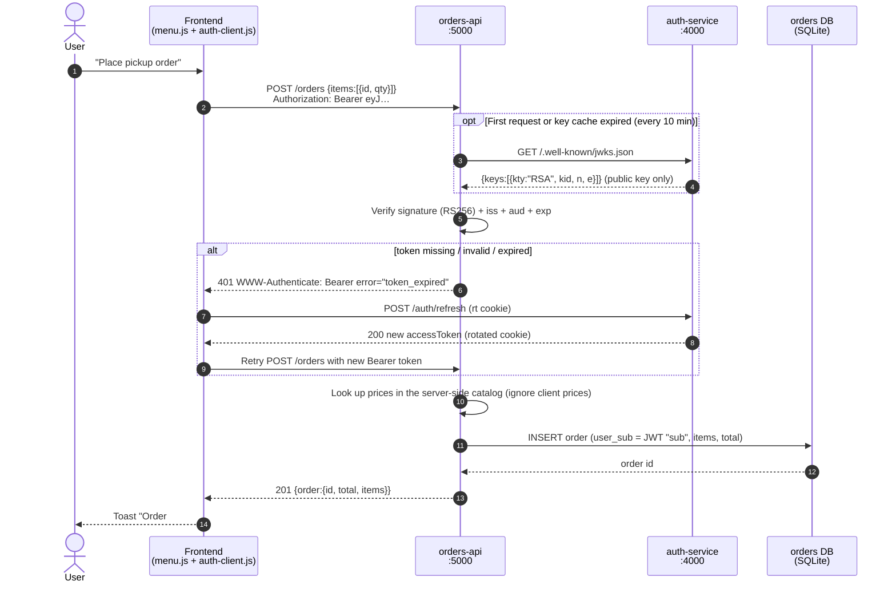
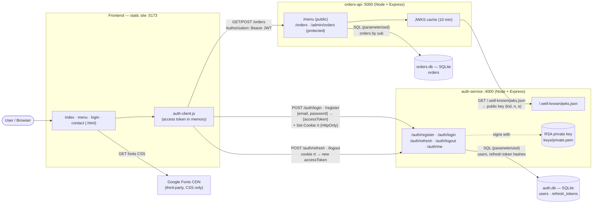
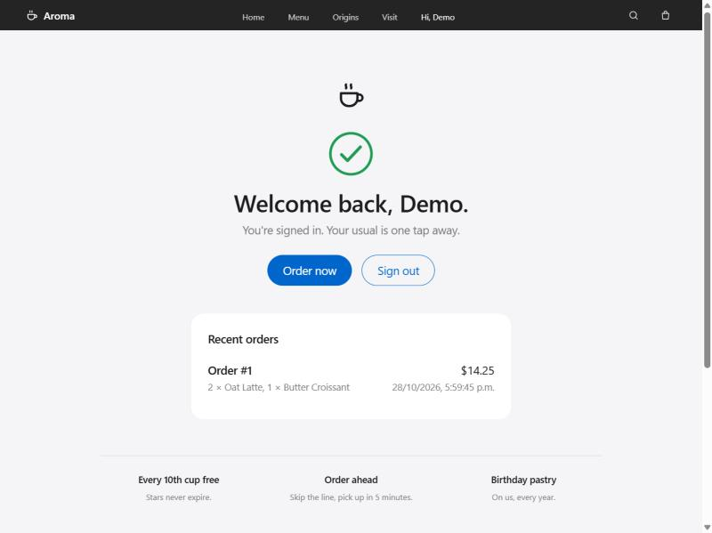
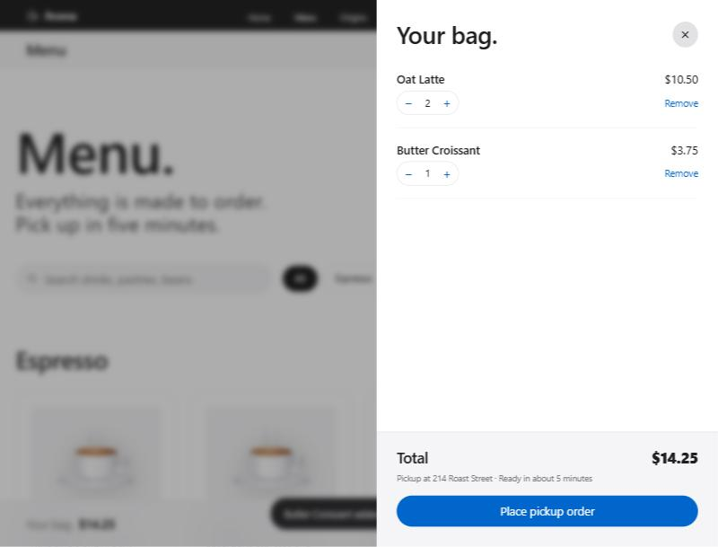
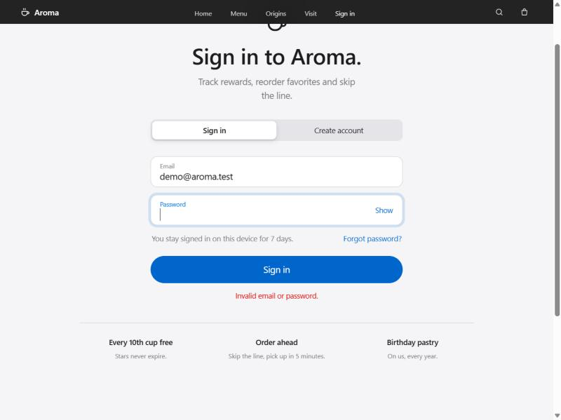
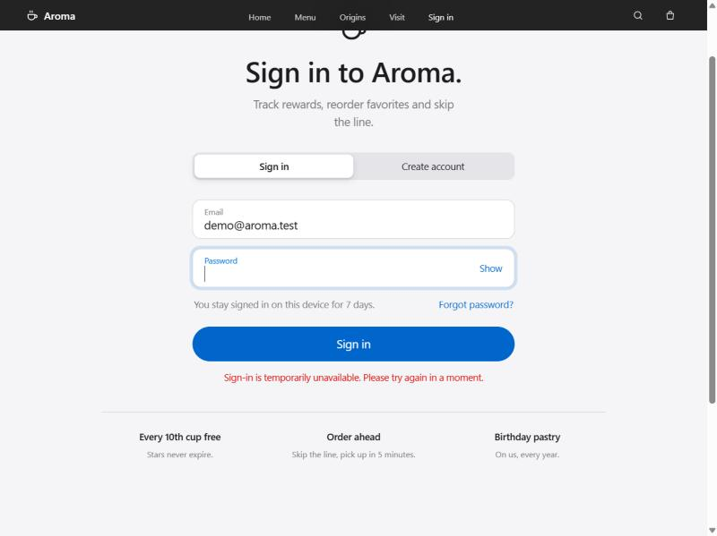

# Authentication System Report — Aroma Café

| | |
| --- | --- |
| **Project** | Aroma Café Web (static website + 2 Node.js microservices) |
| **Activity** | Activity 4 — Authentication through a microservice |
| **Team** | Joshua Rodriguez Carrera *(add teammates here)* |
| **Repository** | <https://github.com/Joshgit4905/hyperlink> |
| **Release** | `v1.1.0` |
| **Date** | October 2026 |

**Summary.** We built our **own authentication microservice**, `auth-service`. It issues short-lived **JWT access tokens signed with RS256** and long-lived, **rotating refresh tokens** stored in an HttpOnly cookie. A second microservice, `orders-api`, is a protected backend. It never talks to the auth database. It verifies every token **locally** with the public key that `auth-service` publishes at a **JWKS** endpoint. The website keeps the access token **in memory only**.

> All screenshots and outputs use a fictional demo account (`demo@aroma.test`). No real passwords, secrets or personal data are included. Tokens and ids are truncated.

---

## 1. Mechanism

### 1.1 What we used and why

| Piece | Choice | Why |
| --- | --- | --- |
| Credential check | Email + password, hashed with **bcrypt** (cost 12) | bcrypt is slow and salted on purpose, so stolen hashes are expensive to crack. |
| Access credential | **JWT** (JSON Web Token), **RS256**, 15 minutes | Stateless: any service can verify it with the public key, without a DB lookup or a call to auth. That is what makes the microservice split work. |
| Signature algorithm | **RS256** (asymmetric) instead of HS256 | With HS256, every service that verifies tokens would also hold the secret to *create* tokens. With RS256, only `auth-service` has the private key, and `orders-api` only gets the public key. |
| Key distribution | **JWKS** endpoint `/.well-known/jwks.json` with a `kid` | This is the standard way resource servers fetch and cache public keys. The `kid` allows key rotation without downtime. |
| Session continuity | **Refresh token**: opaque random string, HttpOnly cookie, 7 days, **rotated** on each use | Short access tokens limit the damage if one leaks. The refresh token keeps the user signed in without storing anything readable by JavaScript. |
| Protocol style | Bearer tokens (RFC 6750) in the `Authorization` header | Simple and works across origins (`:5173` → `:5000`) without cookies on the API. |

**Why not server-side sessions only?** A classic session ID would force `orders-api` to call `auth-service` (or share its DB) on *every* request. That couples the services and creates a single point of failure. JWTs move that check into a signature verification, which takes microseconds and is done locally.

**Why not OAuth 2.0 / OpenID Connect with a provider?** We implement the same building blocks that OAuth 2.0 uses (bearer access tokens, refresh tokens, JWKS, `iss`/`aud` claims). We did not add a third-party identity provider, because the project needs its own customer accounts (rewards, orders) and should run offline for the course. The design is ready to add "Sign in with Google" later as one more way to log in (see 1.2).

### 1.2 Own service vs third-party

| Option | Pros | Cons |
| --- | --- | --- |
| **Own microservice (chosen)** | Full control of data and claims (e.g. `role`). No cost or vendor lock-in. Works offline / on localhost. Great for learning: every step is visible and testable. | **We** are responsible for security: hashing, rate limiting, key storage, patches. No MFA, email verification or password reset out of the box. Must be scaled and monitored by us. |
| **Auth0** | Hosted login, MFA, social logins, breach detection, compliance (SOC 2). Standard OIDC. | Paid above the free tier. Vendor lock-in. User data lives outside our system. Needs internet. |
| **Firebase Authentication** | Very fast to integrate. Free tier. Email and social providers. SDKs for web and mobile. | Tied to Google Cloud. Token format and claims are defined by Firebase. Custom roles need extra work. Needs internet. |
| **Sign in with Google (OIDC)** | Users don't need a new password. Google handles MFA and account recovery. | Only users with a Google account. We still need our own user table and our own session/token for our API. Depends on Google availability. |

**Decision:** own microservice, built with standard pieces (JWT, JWKS, bcrypt). This way a third-party provider can be added later without changing `orders-api`: it only trusts `iss`, `aud` and the JWKS URL.

---

## 2. Flow

### 2.1 Login (and silent session restore)

```mermaid
sequenceDiagram
    autonumber
    actor U as User
    participant FE as Frontend<br/>(login.html + auth-client.js)<br/>:5173
    participant AS as auth-service<br/>:4000
    participant DB as auth DB<br/>(SQLite)

    U->>FE: Types email + password, clicks "Sign in"
    FE->>FE: Client-side validation (format, length)
    FE->>AS: POST /auth/login {email, password}
    AS->>AS: Rate limit check (IP + email, 5 / min)
    AS->>DB: SELECT user WHERE email = ?
    DB-->>AS: user row (password_hash, role)
    AS->>AS: bcrypt.compare(password, hash)
    alt wrong email or password
        AS-->>FE: 401 {"message":"Invalid email or password."}
        FE-->>U: Shows generic error
    else valid
        AS->>AS: Sign JWT (RS256, 15 min) with private key
        AS->>AS: Create random refresh token (256 bit)
        AS->>DB: INSERT refresh_tokens (SHA-256 hash, family, expires)
        AS-->>FE: 200 {accessToken, expiresIn, user}<br/>Set-Cookie: rt=…; HttpOnly; Secure; SameSite=Strict; Path=/auth
        FE->>FE: Keep accessToken in memory, schedule refresh at 14 min
        FE-->>U: "Welcome back, Demo." + "Hi, Demo" in the nav
    end

    Note over FE,AS: On every page load (token is not persisted):
    FE->>AS: POST /auth/refresh (browser sends rt cookie automatically)
    AS->>DB: find token by hash, revoke it, insert new one (rotation)
    AS-->>FE: 200 new accessToken + new rt cookie (or 401 if not signed in)
```

### 2.2 Protected request (place an order), including token renewal



Admin-only routes add one more step after signature verification: `role === "admin"`, otherwise `403 Forbidden`.

---

## 3. Token or session

### 3.1 Access token (JWT)

Real example from our system (demo user; ids truncated). Taken from [`docs/evidence/http-transcript.txt`](evidence/http-transcript.txt):

```json
// header
{ "alg": "RS256", "kid": "0z4po4sskJXMVRl1", "typ": "JWT" }
// payload
{
  "email": "demo@aroma.test",
  "name":  "Demo Customer",
  "role":  "customer",
  "iss":   "http://localhost:4000",
  "aud":   "aroma-api",
  "sub":   "0fe4ecb2…",
  "jti":   "c261acd9…",
  "iat":   1793239342,
  "exp":   1793240242
}
```

| Claim | Meaning | Who checks it |
| --- | --- | --- |
| `sub` | User id (UUID). Orders are linked to it. | orders-api (owner of each order) |
| `email`, `name` | Display data, so the UI and API don't need a DB lookup | Frontend (nav greeting) |
| `role` | `customer` or `admin`, for authorization | orders-api (`/admin/orders`) |
| `iss` | Issuer: the auth-service URL | orders-api rejects tokens from anyone else |
| `aud` | Audience: `aroma-api` | orders-api rejects tokens made for other APIs |
| `iat` / `exp` | Issued at / expires at, **15 minutes** apart | orders-api (`token_expired`) |
| `jti` | Unique token id | Logs / future denylist |
| `kid` (header) | Which public key verifies the signature | orders-api picks the key from the JWKS |

**No secrets in the token.** A JWT is signed, not encrypted: anyone holding it can read the payload. That's why it carries no password, address or payment data.

### 3.2 Refresh token

| Property | Value |
| --- | --- |
| Format | 32 random bytes (base64url). Opaque, not a JWT. |
| Storage (server) | Only its **SHA-256 hash** in `refresh_tokens`, with `family_id`, `expires_at`, `revoked_at`, `replaced_by` |
| Storage (browser) | Cookie `rt` with `HttpOnly; Secure; SameSite=Strict; Path=/auth`. JavaScript cannot read it, and it is sent only to `/auth/*`. |
| Lifetime | **7 days** |

### 3.3 Expiry, renewal and logout strategy

| Event | What happens |
| --- | --- |
| **Expiry** | Access token: 15 min, checked by every API. Refresh token: 7 days, checked by auth-service. |
| **Renewal** | `auth-client.js` calls `POST /auth/refresh` 1 minute before `exp`, on page load, and once after any `401`. Each refresh **rotates** the cookie: the old refresh token is revoked and linked to the new one (`replaced_by`). |
| **Reuse detection** | If a refresh token that was already used shows up again (e.g. stolen and replayed), auth-service **revokes the whole family**, so both the attacker and the user are logged out. Proven in the transcript (section 7). |
| **Logout** | `POST /auth/logout` revokes the refresh-token family in the DB and clears the cookie. The frontend drops the in-memory token. |
| **Known limitation** | An access token that was already issued stays valid until its `exp` (at most 15 min), because APIs verify it without asking auth-service. We accept this trade-off for availability. A `jti` denylist could close it if needed. |
| **Why not localStorage?** | Any XSS could read localStorage and steal a long-lived token. In memory, the token disappears on reload, and the refresh token is out of reach of JavaScript. The website also deletes the old v1.0 `aroma-user` key. |

---

## 4. Architecture

### 4.1 Component diagram



**Rules that keep the components decoupled:**
- **One database per service.** orders-api never reads `auth.db`. It identifies users only by the JWT `sub`.
- **No runtime call from orders-api to auth-service per request.** The only call is the occasional, cached JWKS download.
- **The private key never leaves auth-service.**

### 4.2 Endpoints and data between each pair

| From → To | Endpoint | Data sent | Data returned |
| --- | --- | --- | --- |
| Browser → Frontend | `GET /*.html, /assets/*` | — | HTML, CSS, JS, SVG |
| Frontend → auth-service | `POST /auth/register` | `{name, email, password}` (JSON, HTTPS in prod) | `201 {accessToken, tokenType, expiresIn, user}` + `Set-Cookie: rt` · `400` invalid · `409` email taken |
| Frontend → auth-service | `POST /auth/login` | `{email, password}` | `200 {accessToken, expiresIn:900, user:{id,email,name,role}}` + `Set-Cookie: rt` · `401` generic · `429` rate limited |
| Frontend → auth-service | `POST /auth/refresh` | Cookie `rt` (sent by the browser automatically) | `200` new access token + **new** `rt` cookie · `401 refresh_reused / refresh_expired / no_session` |
| Frontend → auth-service | `POST /auth/logout` | Cookie `rt` | `204` + cookie cleared |
| Frontend → auth-service | `GET /auth/me` | `Authorization: Bearer <JWT>` | `200 {user, tokenExpiresAt}` |
| Frontend → orders-api | `GET /menu` | — | `200 {items:[{id,name,price}]}` (public) |
| Frontend → orders-api | `GET /orders` | `Authorization: Bearer <JWT>` | `200 {orders:[…]}` (only the caller's) · `401` |
| Frontend → orders-api | `POST /orders` | Bearer JWT + `{items:[{id, qty}]}` | `201 {order:{id, items, total, status, createdAt}}` · `400` · `401` |
| Frontend → orders-api | `GET /admin/orders` | Bearer JWT with `role=admin` | `200 {orders}` · `403` for customers |
| orders-api → auth-service | `GET /.well-known/jwks.json` | — | `{keys:[{kty:"RSA", kid, n, e, alg:"RS256", use:"sig"}]}` (cached 10 min) |
| auth-service → auth DB | SQL via `node:sqlite` prepared statements | email, bcrypt hash, refresh token **hash**, family id | user row, token row |
| orders-api → orders DB | SQL via prepared statements | `user_sub`, items JSON, server-computed total | order rows |
| Monitoring → each service | `GET /health` | — | `200 {status:"ok", db:"ok"}` or `503 {db:"down"}` |
| Frontend → Google Fonts | `GET fonts.googleapis.com/css2…` | — | Inter font (optional, cosmetic) |

### 4.3 Ports and how to run

| Component | Port | Start |
| --- | --- | --- |
| Frontend | 5173 | `npm run start:web` |
| auth-service | 4000 | `npm run start:auth` |
| orders-api | 5000 | `npm run start:orders` |

Run `npm run setup` once. Configuration lives in each service's `.env.example` (`AUTH_ISSUER`, `AUTH_AUDIENCE`, `CORS_ORIGIN`, token lifetimes, DB paths).

---

## 5. Failure

| What fails | What the user sees | What still works | How we handle it | Proof |
| --- | --- | --- | --- | --- |
| **auth-service down** | Sign in / register shows *"Sign-in is temporarily unavailable. Please try again in a moment."* (8 s client timeout, no endless spinner). | Users who are **already signed in keep working**: orders-api validates their tokens with the **cached public key** until each token expires (≤ 15 min) or the key cache expires (10 min). The public site, menu and bag also work. | Stateless JWT + JWKS cache. The client keeps the current token if refresh fails because of a network error (not a 401). | E2E test *"auth-service goes down → existing tokens keep working, new logins fail"* + screenshot 04 |
| **auth-service down and orders-api has no cached key** (e.g. orders-api just restarted) | "Sign-in service is unavailable" when loading orders. | Public `/menu`. | orders-api **fails closed** (`503 auth_unavailable`). It never accepts a token it cannot verify. | E2E test *"no cached keys → fails closed with 503"* |
| **Auth database down** | Login/register/refresh: *"Sign-in is temporarily unavailable."* | Existing access tokens on orders-api (same reason as above). | Repository layer turns any DB error into `DbUnavailableError` → `503`, with no stack trace or SQL in the response. `/health` reports `db: "down"`. | Test *"database is down → 503 without leaking details"* |
| **Orders database down** | "Orders are unavailable right now." / toast with the error. | Login, logout and refresh (separate DB). | `503 service_unavailable`, `/health` → `503`. | E2E test *"orders database goes down → 503"* |
| **Third-party API down** (Google Fonts, our only third party) | Nothing breaks: text falls back to the system font (`system-ui` → SF Pro / Segoe UI). | Everything. | `font-display: swap` + font stack fallback. No auth logic depends on a third party. | — |
| **If we added Sign in with Google** | Only the Google button would fail. | Email/password login. | Google is just another way to log in. Our own tokens and API stay the same. | (design) |

**Single points of failure that remain:** auth-service and SQLite run as single instances. In production we would run ≥ 2 auth-service replicas behind a load balancer, move to a managed DB (PostgreSQL) and keep the private key in a secrets manager.

---

## 6. Security

### 6.1 Measures mapped to the OWASP Top 10:2025

| OWASP Top 10:2025 | Risk in our context | Measures applied |
| --- | --- | --- |
| **A01 Broken Access Control** | A user reads another user's orders, or a customer calls admin endpoints. | Every protected route requires a verified JWT. Orders are filtered by the token's `sub`, never by an id from the client. Role check → `403` on `/admin/orders`. CORS allows only `http://localhost:5173`. Tests: forged `role:"admin"` → 401, customer → 403. |
| **A02 Security Misconfiguration** | Verbose errors, permissive CORS, exposed headers. | `helmet` security headers. `x-powered-by` disabled. Strict CORS with an explicit origin and methods. Central error handler with no stack traces. `Cache-Control: no-store` on token responses. 10 kB JSON body limit. `.env.example` only; real `.env`, keys and DBs are git-ignored. |
| **A03 Software Supply Chain Failures** | A malicious or vulnerable npm package. | Few, well-known dependencies (`express`, `jose`, `bcryptjs`, `helmet`, `cors`, `cookie-parser`). `package-lock.json` committed. Built-in `node:sqlite` and `node:test` instead of extra packages. `npm audit` before release. |
| **A04 Cryptographic Failures** | Weak password storage, guessable tokens, shared signing secret. | bcrypt (cost 12). RS256 with a 2048-bit key; the private key is only in auth-service. Refresh tokens are 256-bit random values and only their SHA-256 hash is stored. Cookie `Secure` + `HttpOnly`. HTTPS required in production. |
| **A05 Injection** | SQL injection through email or items; XSS in rendered names. | Only prepared statements with bound parameters. Input validated (email regex, lengths, item ids from a catalog, integer quantities). The frontend writes user data with `textContent` / `escapeHTML`, never raw `innerHTML`. |
| **A06 Insecure Design** | Trusting the client for prices or identity. | The server computes prices from its own catalog. The client price is ignored (test: `price: 0.01` → total 14.25). Identity comes only from the signed token. |
| **A07 Authentication Failures** | Brute force, credential stuffing, user enumeration, session hijacking. | Rate limit: 5 attempts/min per IP + email → `429` with `Retry-After`. Same generic message and similar timing for unknown emails (dummy bcrypt compare). Password policy (≥ 8, letters + numbers). Short-lived access tokens. Refresh rotation with **reuse detection**. Server-side logout. |
| **A08 Software or Data Integrity Failures** | Accepting a modified token or a token signed by someone else. | Signature checked against the JWKS key by `kid`. Algorithm pinned to `RS256` (blocks `alg: none` / HS256 confusion). `iss` and `aud` validated. Tests: tampered payload, foreign key, wrong audience → 401. |
| **A09 Security Logging and Alerting Failures** | Attacks go unnoticed. | Structured JSON audit logs: `login_failed`, `login_rate_limited`, `refresh_reuse_detected`, `access_denied`, `db_unavailable`. Emails masked (`d***@aroma.test`); passwords and tokens never logged. |
| **A10 Mishandling of Exceptional Conditions** | Fail-open when a dependency breaks; leaking internals in errors. | **Fail closed:** no verifiable key → `503`, never "allow". DB errors → `503` with a generic message. Client timeout of 8 s. Tests for every outage case in section 5. |

### 6.2 Remaining risks (honest list)

| Risk | Impact | Mitigation we would add next |
| --- | --- | --- |
| No MFA, no email verification, no password reset | Account takeover if a password is reused elsewhere | TOTP/WebAuthn, verification email, reset link with a one-time token |
| Access token can't be revoked before `exp` | Up to 15 min of access after logout or a role change | Shorter TTL or a `jti` denylist checked by APIs |
| In-memory token is still readable by an XSS bug on our pages | Token theft for ≤ 15 min | Content-Security-Policy on the static site, Trusted Types, keep avoiding `innerHTML` with user data |
| Rate limiter is in memory, single instance | Resets on restart; doesn't work across replicas | Redis-based limiter, account lockout with back-off, CAPTCHA after N failures |
| Local development uses HTTP | Credentials could be sniffed on a shared network | HTTPS everywhere in production (TLS at the reverse proxy), HSTS |
| RSA private key is a file on disk | Server compromise = forged tokens | Secrets manager / KMS, scheduled key rotation (the `kid` already supports it) |
| No CSRF token on `/auth/refresh` and `/auth/logout` | Low: `SameSite=Strict` + CORS already block cross-site use | Add a CSRF header check if the cookie policy is ever relaxed |
| Role promotion is manual (DB update) | Operator error | Admin tooling with audit trail |

---

## 7. Evidence

All evidence comes from the repository: <https://github.com/Joshgit4905/hyperlink>. Run it yourself with `npm run setup && npm test`.

### 7.1 Automated tests: 23 / 23 passing

Full output: [`docs/evidence/test-output.txt`](evidence/test-output.txt). Sources: [`services/auth-service/test/auth.test.js`](../services/auth-service/test/auth.test.js) and [`services/orders-api/test/e2e.test.js`](../services/orders-api/test/e2e.test.js).

```text
> aroma-auth-service@1.0.0 test
✔ register creates an account and returns a session
✔ register rejects a duplicate email with 409
✔ register rejects a weak password with 400
✔ login with the right password returns a signed RS256 JWT with the expected claims
✔ login with a wrong password returns a generic 401
✔ login for an unknown email returns the same generic 401
✔ GET /auth/me works with the bearer token and fails without it
✔ JWKS exposes only the public key
✔ refresh rotates the refresh token, and reusing the old one revokes the session
✔ logout revokes the refresh token
✔ login is rate limited after repeated failures
✔ when the database is down, health and login answer 503 without leaking details
ℹ tests 12  ℹ pass 12  ℹ fail 0

> aroma-orders-api@1.0.0 test
✔ public menu is available without signing in
✔ protected endpoint without a token answers 401 with WWW-Authenticate
✔ login at auth-service, then place an order at orders-api with the Bearer token
✔ a tampered token is rejected
✔ a token signed by someone else's key is rejected
✔ an expired token is rejected with token_expired
✔ a token for another audience is rejected
✔ role-based access: customers get 403 on /admin/orders, staff get 200
✔ FAILURE: auth-service goes down → existing tokens keep working, new logins fail
✔ FAILURE: auth-service down and no cached keys → orders-api fails closed with 503
✔ FAILURE: orders database goes down → 503, no internal details
ℹ tests 11  ℹ pass 11  ℹ fail 0
```

### 7.2 Live HTTP transcript (services running on localhost)

Full file: [`docs/evidence/http-transcript.txt`](evidence/http-transcript.txt). Generated against the running services; tokens truncated.

```text
$ curl -i -X POST http://localhost:4000/auth/login -d '{"email":"demo@aroma.test","password":"<demo>"}'
HTTP/1.1 200 OK
set-cookie: rt=6fVRLfu7rj…(opaque); Max-Age=604800; Path=/auth; HttpOnly; Secure; SameSite=Strict
cache-control: no-store
{"accessToken":"eyJhbGciOiJSUzI1…(JWT truncated)","tokenType":"Bearer","expiresIn":900,"user":{…,"role":"customer"}}

$ curl -i http://localhost:5000/orders                      # no token
HTTP/1.1 401 Unauthorized
www-authenticate: Bearer error="missing_token"

$ curl -i http://localhost:5000/orders -H "Authorization: Bearer eyJ…"
HTTP/1.1 200 OK
{"orders":[{"id":1,"items":[…],"total":14.25,"status":"received",…}]}

$ curl -i http://localhost:5000/admin/orders -H "Authorization: Bearer eyJ…"   # role=customer
HTTP/1.1 403 Forbidden

$ curl -i http://localhost:5000/orders -H "Authorization: Bearer <tampered signature>"
HTTP/1.1 401 Unauthorized
www-authenticate: Bearer error="invalid_token"

$ curl -i -X POST http://localhost:4000/auth/refresh --cookie "rt=<cookie #1>"
HTTP/1.1 200 OK          ← new access token + rotated cookie #2
$ curl -i -X POST http://localhost:4000/auth/refresh --cookie "rt=<cookie #1>"   # replay
HTTP/1.1 401 Unauthorized  {"error":"refresh_reused"}
$ curl -i -X POST http://localhost:4000/auth/refresh --cookie "rt=<cookie #2>"
HTTP/1.1 401 Unauthorized  ← whole family revoked

$ curl -i -X POST http://localhost:4000/auth/logout --cookie "rt=<cookie #3>"
HTTP/1.1 204 No Content
$ curl -i -X POST http://localhost:4000/auth/refresh --cookie "rt=<cookie #3>"   # after logout
HTTP/1.1 401 Unauthorized
```

### 7.3 Browser network log (real UI flow)

Captured from the browser while using the website (demo account):

```text
POST http://localhost:4000/auth/refresh   → 401 Unauthorized   (page load, not signed in yet)
OPTIONS http://localhost:4000/auth/register → 204             (CORS preflight)
POST http://localhost:4000/auth/register  → 201 Created        (account + session)
GET  http://localhost:5000/orders         → 200 OK             (protected: recent orders)
GET  http://localhost:5173/menu.html      → 200 OK             (navigation: token in memory is gone)
POST http://localhost:4000/auth/refresh   → 200 OK             (silent restore via HttpOnly cookie)
POST http://localhost:5000/orders         → 201 Created        (protected: place order)
```

Checked in the browser console after signing in: `Object.keys(localStorage)` → `["aroma-bag"]`. **No token is stored in web storage.**

### 7.4 Screenshots

| | |
| --- | --- |
| **Signed in: data from the protected `GET /orders`**  | **Bag before the protected `POST /orders`**  |
| **Wrong password: generic 401 message**  | **auth-service stopped: graceful failure**  |

### 7.5 Where to find the code

| Part | Path |
| --- | --- |
| Auth routes, rotation, rate limit, error handling | [`services/auth-service/src/app.js`](../services/auth-service/src/app.js) |
| JWT signing / refresh token hashing | [`services/auth-service/src/tokens.js`](../services/auth-service/src/tokens.js) |
| RSA keys + JWKS | [`services/auth-service/src/keys.js`](../services/auth-service/src/keys.js) |
| Auth DB schema | [`services/auth-service/src/db.js`](../services/auth-service/src/db.js) |
| JWT verification middleware (JWKS, fail-closed) | [`services/orders-api/src/auth.js`](../services/orders-api/src/auth.js) |
| Protected routes + server-side prices | [`services/orders-api/src/app.js`](../services/orders-api/src/app.js) |
| Browser client (memory token, silent refresh) | [`assets/js/auth-client.js`](../assets/js/auth-client.js) |
| Sign-in UI | [`login.html`](../login.html), [`assets/js/login.js`](../assets/js/login.js) |

### 7.6 Git history for this feature

| PR | Branch → base | Content |
| --- | --- | --- |
| #7 | `feature/auth-service` → `develop` | auth microservice + 12 tests |
| #8 | `feature/orders-api` → `develop` | protected API + 11 end-to-end tests |
| #9 | `feature/auth-frontend` → `develop` | website connected to both services |
| #10 | `docs/auth-report` → `develop` | this report + evidence |
| #11 | `develop` → `main` | Release `v1.1.0` |
